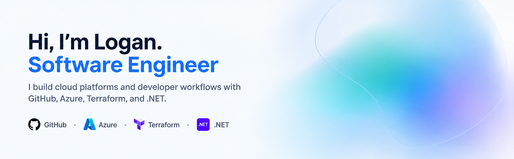

<picture>
  <source media="(prefers-color-scheme: dark)" srcset=".assets/banner/dark.png">
  <source media="(prefers-color-scheme: light)" srcset=".assets/banner/light.png">
  
</picture>

 

  
  

## About me

I'm a Software Engineer with a passion for building scalable, cloud-native solutions using C#, .NET, and Azure. With over five years of experience across Belgium's public, banking, and energy sectors, I focus on creating clean, reliable systems that drive real impact.

Currently a **Consultant, Full-Stack Developer** at [Avanade](https://www.avanade.com), where I architect and deliver enterprise-grade solutions using Azure, Infrastructure as Code, and clean architectural patterns — and mentor junior developers along the way.

<h2>GitHub Certifications</h2>

<em>I'm really enjoying my time on GitHub — I'm getting certified shortly, already hold partner certifications, and currently rank in the <a href="https://github.com/andrediasbr/github-certification-ranking/blob/main/TOP10_WORLD.md">top 10 globally</a> for GitHub certifications.</em>

  
  
  
  

<h2>Explore</h2>

- **[Experience](https://www.loganfarci.com/about#experience)** — learn about my work experience and projects
- **[Articles](https://www.loganfarci.com/articles)** — what I'm currently exploring and writing about
- **[Certifications](https://www.loganfarci.com/about#certifications)** — credentials behind my current work
